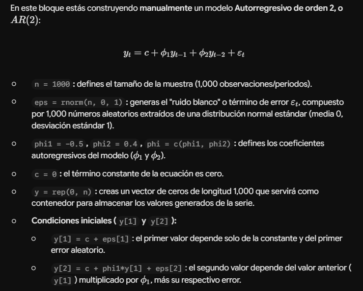

1.  Paquetes a usar en la clase En esta sección estás cargando paquetes de R orientados principalmente al análisis de series de tiempo financieras y gestión de riesgo:

fGarch: Se utiliza para modelar volatilidad (modelos GARCH y variantes) y procesos estocásticos no constantes.

tseries: Paquete fundamental para el análisis de series temporales (incluye pruebas de autocorrelación, modelos ARMA, pruebas de estacionariedad, etc.).

fUnitRoots: Contiene pruebas para verificar si una serie de tiempo tiene raíces unitarias (es decir, si la serie es no estacionaria, como las pruebas Dickey-Fuller).

QRM (Quantitative Risk Management): Proporciona funciones avanzadas para la gestión de riesgo cuantitativo (cálculo de Valor en Riesgo, Teoría de Valores Extremos, copulas, etc.).

```{r}
library(fGarch)
library(tseries)
library(fUnitRoots)
library(QRM)
```



```{r}
n = 1000
eps = rnorm(n,0,1)
phi1 = -0.5
phi2 = 0.4
phi = c(phi1,phi2)
c=0
y = rep(0,n)
y[1] = c + eps[1]
y[2] = c + phi1*y[1] + eps[2]
```

```{r}
for (i in 3:n){
  y[i] = c + phi1*y[i-1] + phi2*y[i-2] + eps[i]
}
```

```{r, fig.width=15, fig.height=10}
par (mfrow=c(3,1))
plot(y,typ="l",col="red")
acf(y,100)
pacf(y,100)
```

Varianza

```{r}
fit.ar2 =arima (y,order = c(2,0,0))
coef = fit.ar2$coef
var.coef =1.96*sqrt(fit.ar2$var.coef)#aqui se llama var.coef por varianza, pero el profe aplico sqrt para sacar la desviacion estandar
print(coef)
print(var.coef)
```

```{r, fig.width=15, fig.height=10}
residuos = fit.ar2$residuals
par(mfrow=c(3,1))
plot(residuos,typ="l",col="red")
acf(residuos,20)
pacf(residuos,20)
summary(residuos)
```

#MA2

```{r}
theta1= -1.6
theta2= -0.65
y1 = rep(0,n)
mu = 0 
y1[1] =mu + eps[1]
y1[2] =mu - theta1*eps[1] + eps[2]

```

```{r}
for (i in 3:n){
  y1[i] = mu - theta1*eps[i-1] - theta2*eps[i-2] + eps[i]
}
```

```{r, fig.width=15, fig.height=10}
par (mfrow=c(3,1))
plot(y,typ="l",col="red")
acf(y1,20)
pacf(y1,20)
```

```{r}
fit.ma2 =arima (y1,order = c(0,0,2))
coef = fit.ma2$coef
var.coef =1.96*sqrt(fit.ma2$var.coef)
print(coef)
print(var.coef)
```

```{r, fig.width=15, fig.height=10}
residuos = fit.ma2$residuals
par(mfrow=c(3,1))
plot(residuos,typ="l",col="red")
acf(residuos,20)
pacf(residuos,20)
summary(residuos)
```
#ARMA(2,2)


```{r}
y2 = rep(0,n)
y2[1] = eps[1]
y2[2] = phi1*y2[1] - theta1*eps[1] + eps[2]
```

```{r}
for (i in 3:n){
  y2[i] = phi1*y2[i-1] + phi2*y2[i-2] - theta1*eps[i-1] - theta2*eps[i-2] + eps[i] 
}
```

```{r, fig.width=15, fig.height=10}
par (mfrow=c(3,1))
plot(y2,typ="l",col="red")
acf(y2,20)
pacf(y2,20)
```

```{r}
fit.arma22 =arima (y2,order = c(2,0,2))
coef = fit.arma22$coef
var.coef =(fit.arma22$var.coef)
print(coef)
print(var.coef)
```

```{r, fig.width=15, fig.height=10}
residuos = fit.arma22$residuals
par(mfrow=c(3,1))
plot(residuos,typ="l",col="red")
acf(residuos,20)
pacf(residuos,20)
summary(residuos)
```


